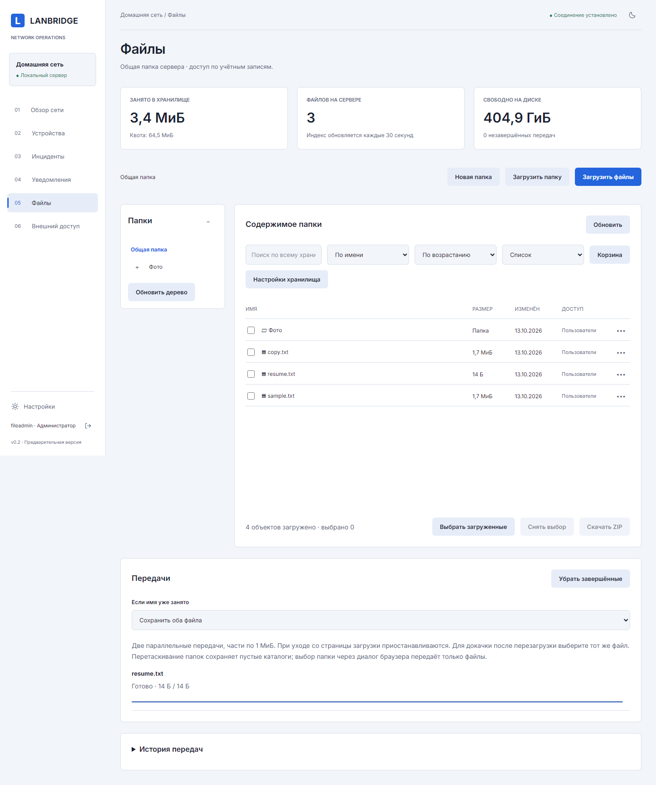
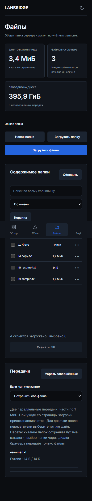

# LANBridge

Локальный файловый сервер и монитор сети со встроенным веб-интерфейсом.
Текущая Go-версия собирается в один исполняемый файл, хранит данные в SQLite
и открывает интерфейс по HTTPS. Статус: разработка и приёмка, релиз ещё не объявлен.

**Лицензия:** [MIT](LICENSE) · **Сборка:** Go 1.27.2 / Node.js 24 ·
[Изменения](CHANGELOG.md) · [Остаток работ](docs/progress.md)

Этот README относится к Go-версии. Для прежнего приложения на Python сохранена
[отдельная инструкция](README.python.md). Автоматического переноса его БД нет.

## Возможности

- **Файлы:** папки, поиск, список/плитки, загрузка с докачкой и SHA-256,
  скачивание с Range, ZIP, предпросмотр PDF/медиа/текста, корзина, квоты и права папок.
- **Мониторинг:** HTTP(S), TCP, ICMP, DNS, heartbeat, графики, инциденты,
  обнаружение устройств, диагностика и показатели ресурсов процесса.
- **Внешний доступ:** временные ссылки с паролем и лимитами, QR-коды,
  Cloudflare Quick Tunnel с отдельным гостевым шлюзом.
- **Безопасность:** роли, HTTPS, Argon2id, CSRF, ограничение входа,
  отзыв сессий, журнал аудита, резервные копии и восстановление SQLite.

Telegram, SMTP и Webhook подключаются через очередь уведомлений.
Реальная доставка во внешние сервисы ещё требует приёмки с настроенными адресатами.

## Скриншоты

| Десктоп, светлая тема | Телефон, тёмная тема |
|---|---|
|  |  |

[Галерея обеих тем и размеров экрана](docs/previews/index.html).
Это снимки браузерных сценариев на тестовой базе.

## Требования

Для сборки: Windows, PowerShell, Go 1.27.2, Node.js 24 и npm.
Для запуска готового бинарника Go, Node.js и Python не нужны.
Порт по умолчанию — **8766**; старое Python-приложение использует 8765.
Доступность ICMP/ARP зависит от ОС, разрешений и брандмауэра.

Windows проверена на текущем компьютере и в чистом локальном клоне.
Linux amd64 успешно собран с Windows; запуск Linux, systemd и Docker пока
не подтверждён. [Подготовленные способы развёртывания](docs/go-deployment.md).

## Быстрый старт: Windows PowerShell

Откройте PowerShell в корне этого репозитория:

```powershell
.\build.ps1
.\dist\lanbridge.exe
```

Откройте **https://localhost:8766/** и создайте первого администратора.
Без конфигурации используются локальный интерфейс и каталог `runtime`.
Проверка чистого клона включает сборку, HTTPS, создание администратора и перезапуск.

Для собственной конфигурации скопируйте пример один раз:

```powershell
Copy-Item go-config.example.yaml config.go.yaml
.\dist\lanbridge.exe -config config.go.yaml
```

Не заменяйте уже настроенный `config.go.yaml`. Если SDK находится вне PATH,
скрипт сборки поддерживает переменную `LANBRIDGE_GO_TOOLCHAIN`.

## Первая настройка и конфигурация

В `config.go.yaml` задаются интерфейс и порт, пути хранилища, TLS, журналы,
резервные копии и путь к cloudflared. Параметры процесса переопределяют YAML;
поддерживается `.env.go` рядом с конфигурацией.
[Полная таблица параметров и переменных](docs/go-foundation.md#параметры).

По умолчанию создаётся локальный самоподписанный сертификат. Предупреждение
браузера исчезает только при корректном сертификате для выбранного имени/IP
и доверии к его издателю на каждом клиенте. Собственную PEM-пару можно задать
через `server.cert` и `server.key`. Секретный ключ нельзя передавать клиентам.

Для телефона нужен доступный LAN-адрес сервера, соответствующий `server.host`
и разрешение входящих соединений в брандмауэре. `localhost` на телефоне указывает
на сам телефон. Проверка настоящим телефоном пока остаётся в плане приёмки.

В интерфейсе настраиваются оформление, логотип, порядок карточек, стартовая
страница, часовой пояс, интервал новых проверок (5–86400 с, по умолчанию 20)
и хранение агрегированной истории (30–365 дней, по умолчанию 365).
Сокращение срока удаляет старые агрегаты при следующем обслуживании;
исходные измерения хранятся 48 часов.

## Использование

- **Передача:** откройте «Файлы», выберите папку и загрузите или перетащите файлы.
  Докачка, квоты, права и операции описаны в [руководстве по файлам](docs/go-files.md).
- **Ссылки и QR:** создайте ссылку на файл, задайте срок, пароль и лимит,
  затем скопируйте URL или откройте QR. [Руководство](docs/go-shares.md).
- **Обзор:** добавьте проверки в WAN, LAN или свою группу; выберите группу и период
  графика. Uptime — доля успешных измерений. [Мониторинг](docs/go-foundation.md#мониторинг).
- **Инциденты и доставка:** настройте канал и правила.
  [Уведомления](docs/go-notifications.md), [устройства](docs/go-devices.md).

## Внешний доступ и безопасность

Cloudflare включается администратором с подтверждением, после перезапуска
остаётся выключенным. Наружу публикуется гостевой шлюз.
[Настройка, отключение и ограничения](docs/go-external.md).
NetBird и SSH пока не реализованы. Реальный Cloudflare/WAN ещё не прошёл приёмку.

Основные угрозы: утечка публичной ссылки, подбор пароля, избыточные права папок,
нежелательная публикация файлов и потеря локального диска. Используйте отдельные
учётные записи, ограниченные ссылки, права папок и независимые резервные копии.
[Аудит](docs/go-audit.md), [SQLite и восстановление](docs/go-database.md).

## Архитектура и API

`cmd/lanbridge` запускает HTTPS-сервер и фоновые службы; `internal` содержит
API, хранение, мониторинг и туннели; `web/src` — Preact-интерфейс.
Статика встроена в бинарник. SQLite хранит настройки и историю, файлы лежат
в отдельном хранилище. SSE доставляет изменения открытым вкладкам.

API и ограничения описаны по подсистемам:
[основной API](docs/go-foundation.md), [файлы](docs/go-files.md),
[ссылки](docs/go-shares.md), [внешний доступ](docs/go-external.md).
Маршрут Swagger `/docs` старой Python-версии не является документацией Go API.
Изменяющие запросы требуют сессию и CSRF; heartbeat использует отдельный токен.

## Разработка и проверки

При Go в PATH:

```powershell
go test ./...
go vet ./...
```

[Браузерные проверки и чистый клон](docs/go-foundation.md),
[нагрузочный сценарий](docs/go-soak.md), [результаты замеров](docs/performance.md).
Python используется только для вспомогательных сценариев проверок.

Разработка идёт в `dev`, крупные изменения — в `feature/*` или тематических ветках.
Коммиты используют Conventional Commits. `main` ещё содержит прежнюю версию;
переключение стабильной ветки и тег выполняются после приёмки.
Данные, сертификаты, `.env` и пользовательские файлы в Git не включаются.

## Решение проблем

| Симптом | Что проверить |
|---|---|
| Порт занят | Измените `server.port` или остановите процесс, который занял 8766 |
| Страница не открывается | Сервер должен работать; проверьте HTTPS, адрес и порт |
| Телефон не подключается | LAN-адрес, `server.host`, брандмауэр и отсутствие изоляции Wi-Fi клиентов |
| Сертификат не доверен | Имя/IP в сертификате и доверие к его издателю на клиенте |
| Устройства не найдены | Подсеть, ICMP/ARP, права и сетевую изоляцию; контейнер видит другую сеть |
| Туннель не запускается | Путь к cloudflared, исходящий доступ и журнал провайдера |
| 401 / 403 | Вход, роль, права папки и CSRF; другое имя сервера означает отдельную сессию |
| Пропали данные после переноса | Пути `storage.data` / `storage.root` и отдельную резервную копию данных |

## Состояние выпуска

Пройдены Go-тесты, `go vet`, JavaScript-тесты, браузерные сценарии,
чистая сборка Windows, передача 20 ГиБ с докачкой и параллельные передачи 3 × 5 ГиБ.
Первый длительный прогон завершился ошибкой клиента; новый суточный прогон запущен
19 октября. До успешного завершения он не подтверждает суточную стабильность.

Остаются реальные проверки служб, Linux/контейнера, телефона, внешних сервисов,
физического сетевого сбоя и заполнения диска. [Актуальный список](docs/progress.md).
WebDAV и дополнительные языки не входят в обязательный остаток.

Лицензия — [MIT](LICENSE). Используются Go, Preact, SQLite, PDF.js и другие
зависимости с собственными лицензиями; файлы лицензий входят в сборку.
